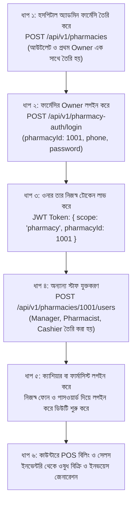

# 🏥 Netro Hospital Management System — ফার্মেসি ব্যাকএন্ড ডকুমেন্টেশন (Bangla Documentation)

এই ডকুমেন্টেশনে **Netro Hospital Backend**-এ ফার্মেসি মডিউলের জন্য যা যা তৈরি ও ইমপ্লিমেন্ট করা হয়েছে তার বিস্তারিত ব্যাখ্যা দেওয়া হলো। এতে ডাটাবেজ স্কিমা, ফিল্ডসমূহ, এপিআই এন্ডপয়েন্ট, রোল ও সিকিউরিটি আর্কিটেকচার এবং ধাপে ধাপে কাজের সম্পূর্ণ ফ্লো ("কার পর কী হবে") উল্লেখ করা আছে।

---

## ১. ওভারভিউ ও আর্কিটেকচার (Overview & Architecture)

### ১.১ মাল্টি-ফার্মেসি আউটলেট (Multi-tenant Pharmacy Outlets)
- হসপিটালের অধীনে এক বা একাধিক স্বাধীন বা ব্রাঞ্চ ফার্মেসি আউটলেট পরিচালিত হতে পারে।
- প্রতিটি ফার্মেসির একটি স্বয়ংক্রিয় ইউনিক কোড বা আইডি থাকে যা **১০০১ (1001)** থেকে শুরু হয় (যেমন: #1001, #1002)।

### ১.২ ডুয়াল অথেনটিকেশন সিস্টেম (Dual Authentication System)
- **হসপিটাল অ্যাডমিন ও স্টাফ**: `/api/v1/auth/login` এ ইমেইল ও পাসওয়ার্ড দিয়ে লগইন করে।
- **ফার্মেসি ইউজারগণ**: `/api/v1/pharmacy-auth/login` এ তিনটি তথ্য দিয়ে লগইন করে:
  1. `pharmacyId` (ফার্মেসির আইডি, যেমন: 1001)
  2. `phone` (ইউজারের মোবাইল নম্বর)
  3. `password` (পাসওয়ার্ড)
- **টোকেন আইসোলেশন (JWT Scoping)**: ফার্মেসি টোকেনে `{ scope: "pharmacy", pharmacyId: 1001 }` থাকে। একজন ফার্মেসি ইউজার কেবল তার নিজস্ব ফার্মেসির ডাটা অ্যাক্সেস করতে পারে। অন্যদিকে হসপিটাল অ্যাডমিন সব ফার্মেসির ডাটা সুপারভাইজ করতে পারে।
- **মোবাইল নম্বর ইউনিকনেস**: ফোন নম্বর ফার্মেসিভিত্তিক ইউনিক (`(pharmacyId, phone)` কম্পোজিট ইউনিক ইনডেক্স)। অর্থাৎ একই ব্যক্তি প্রয়োজনে দুটি ভিন্ন ফার্মেসিতে কাজ করতে পারবেন।

---

## ২. ডাটাবেজ টেবিল ও ফিল্ডের বিবরণ (Database Schema & Fields)

### ২.১ `pharmacies` টেবিল (আউটলেট রেজিস্ট্রি)
হসপিটালের অধীনস্থ প্রতিটি ফার্মেসি আউটলেটের মূল তথ্য এখানে সংরক্ষিত থাকে।

| ফিল্ডের নাম | ডাটা টাইপ | বাধ্যবাধকতা | বিবরণ |
| :--- | :--- | :--- | :--- |
| `id` | `integer` | Primary Key | ১০০১ থেকে স্বয়ংক্রিয়ভাবে তৈরি (Generated by Identity, start 1001) |
| `name` | `varchar(255)` | Not Null | ফার্মেসির নাম (যেমন: Netro Care Pharmacy) |
| `address` | `varchar(500)` | Not Null | ফার্মেসির বিস্তারিত ঠিকানা |
| `phone` | `varchar(50)` | Not Null | ফার্মেসির প্রধান যোগাযোগ নম্বর |
| `email` | `varchar(255)` | Optional | ফার্মেসির অফিসিয়াল ইমেইল (থাকলে) |
| `licenseNo` | `varchar(100)` | Unique, Not Null | ড্রাগ লাইসেন্স নম্বর (সিস্টেমে ডুপ্লিকেট হতে পারবে না) |
| `isActive` | `boolean` | Default `true` | ফার্মেসি সক্রিয় নাকি নিষ্ক্রিয় |
| `createdBy` | `varchar(64)` | Nullable | যে হসপিটাল অ্যাডমিন এটি তৈরি করেছেন তার ইউজার আইডি |
| `createdAt` | `timestamp` | Default `Now()` | তৈরির সময় |
| `updatedAt` | `timestamp` | Default `Now()` | সর্বশেষ আপডেটের সময় |

---

### ২.২ `pharmacy_users` টেবিল (ফার্মেসি স্টাফ ও অ্যাক্সেস)
ফার্মেসির ওনার, ম্যানেজার, ফার্মাসিস্ট এবং ক্যাশিয়ারদের অ্যাকাউন্ট।

| ফিল্ডের নাম | ডাটা টাইপ | বাধ্যবাধকতা | বিবরণ |
| :--- | :--- | :--- | :--- |
| `id` | `varchar(64)` | Primary Key | ইউনিক আইডি প্রিফিক্স সহ (যেমন: `phu-179433...`) |
| `pharmacyId` | `integer` | Foreign Key | `pharmacies.id`-এর সাথে যুক্ত (On Delete Cascade) |
| `name` | `varchar(255)` | Not Null | কর্মীর নাম |
| `phone` | `varchar(50)` | Not Null | কর্মীর ফোন নম্বর (লগইন আইডেন্টিফায়ার) |
| `email` | `varchar(255)` | Optional | কর্মীর ইমেইল |
| `password` | `varchar(255)` | Not Null | হ্যাশ করা পাসওয়ার্ড (Bcrypt 10 rounds) |
| `role` | `varchar(50)` | Default `staff` | রোল: `owner`, `manager`, `pharmacist`, `cashier`, `staff` |
| `isActive` | `boolean` | Default `true` | কর্মী সক্রিয় কিনা (false হলে লগইন ব্লক) |
| `lastLoginAt` | `timestamp` | Nullable | সর্বশেষ লগইনের তারিখ ও সময় |
| `createdAt` | `timestamp` | Default `Now()` | যোগদানের সময় |
| `updatedAt` | `timestamp` | Default `Now()` | প্রোফাইল পরিবর্তনের সময় |

> 🔒 **রোল ও সুরক্ষার নিয়ম (Business Rules)**:
> 1. প্রতিটি ফার্মেসিতে অবশ্যই কমপক্ষে একজন সক্রিয় `owner` থাকতে হবে (শেষ ওনারকে ডিঅ্যাক্টিভেট বা ডিলিট করা যাবে না)।
> 2. কোনো ইউজার নিজে নিজের রোল পরিবর্তন বা নিজেকে ডিলিট করতে পারবেন না।
> 3. `owner` পরিচালনা করতে পারে: `manager`, `pharmacist`, `cashier`, `staff`।
> 4. `manager` পরিচালনা করতে পারে: `pharmacist`, `cashier`, `staff`। কোনো ম্যানেজার ওনার বা অন্য ম্যানেজারকে পরিবর্তন/রিমুভ করতে পারে না।

---

### ২.৩ `medicines` টেবিল (ওষুধ ও মাল্টি-ইউনিট স্টক)
ওষুধের বিস্তারিত ও মাল্টি-ইউনিট প্যাকেজিং (কার্টুন, পাতা, পিস) হিসাব।

| ফিল্ডের নাম | ডাটা টাইপ | বিবরণ |
| :--- | :--- | :--- |
| `id` | `varchar(64)` | প্রাইমারি কি |
| `name` | `varchar(255)` | ওষুধের বাণিজ্যিক ব্র্যান্ড নাম (যেমন: Napa Extra 500mg) |
| `generic` | `varchar(255)` | জেনেরিক নাম (যেমন: Paracetamol + Caffeine) |
| `category` | `varchar(100)` | ক্যাটাগরি (যেমন: Tablet, Capsule, Syrup, Injection) |
| `cartonQty` | `integer` | দোকানে মজুত থাকা মোট কার্টুন সংখ্যা |
| `packetPerCarton`| `integer` | প্রতি কার্টুনে কত পাতা/প্যাকেট থাকে (যেমন: ১০ পাতা) |
| `piecePerPacket` | `integer` | প্রতি পাতায় কত পিস/ট্যাবলেট থাকে (যেমন: ১০ পিস) |
| `totalPieces` | `integer` | মোট পিস সংখ্যা (`cartonQty * packetPerCarton * piecePerPacket`) |
| `unitSellingPrice`| `numeric(10,2)` | প্রতি পিস বিক্রয়মূল্য |
| `stripSellingPrice`| `numeric(10,2)` | প্রতি পাতা বিক্রয়মূল্য |
| `batchNo` | `varchar(100)` | ব্যাচ নম্বর |
| `expiryDate` | `varchar(50)` | মেয়াদোত্তীর্ণ হওয়ার তারিখ (YYYY-MM-DD) |
| `minThresholdPieces`| `integer` | স্টক সতর্কতা লেভেল (এর নিচে নামলে Low Stock Alert দিবে) |
| `supplier` | `varchar(255)` | সরবরাহকারী কোম্পানির নাম (যেমন: Square Pharmaceuticals) |
| `branch` | `varchar(255)` | ফার্মেসির শাখা/নাম |

---

### ২.৪ `pharmacy_invoices` টেবিল (POS বিলিং ও বিক্রয় রসিদ)
কাউন্টারে ওষুধ বিক্রির ইনভয়েস ও রসিদ সংক্রান্ত ডাটা।

| ফিল্ডের নাম | ডাটা টাইপ | বিবরণ |
| :--- | :--- | :--- |
| `id` | `varchar(64)` | প্রাইমারি কি |
| `invoiceNo` | `varchar(100)` | ইউনিক ইনভয়েস নম্বর (যেমন: `PHARM-2026-0001`) |
| `customerName` | `varchar(255)` | ক্রেতা বা রোগীর নাম |
| `phone` | `varchar(50)` | কাস্টমারের মোবাইল নম্বর |
| `memberId` | `varchar(50)` | মেম্বারশিপ থাকলে মেম্বার আইডি |
| `isMember` | `boolean` | নিবন্ধিত মেম্বার কিনা |
| `hasPrescription`| `boolean` | ডাক্তারের প্রেসক্রিপশন আছে কিনা |
| `subtotal` | `numeric(10,2)` | ওষুধগুলোর মোট মূল্য |
| `discountAmount` | `numeric(10,2)` | মোট ছাড়ের পরিমাণ (টাকায়) |
| `discountPercentage`| `numeric(5,2)` | ছাড়ের শতকরা হার |
| `grandTotal` | `numeric(10,2)` | সর্বমোট প্রদেয় বিল |
| `status` | `varchar(50)` | বিলের অবস্থা (`Paid`, `Due`, `Partial`) |
| `whatsappSent` | `boolean` | হোয়াটসঅ্যাপে বিল কপি পাঠানো হয়েছে কিনা |
| `smsSent` | `boolean` | এসএমএসে বিল নিশ্চিতকরণ বার্তা গেছে কিনা |
| `items` | `jsonb` | ক্রয়কৃত ওষুধের তালিকা (Medicine ID, নাম, ইউনিট, পরিমাণ, দর, মোট) |

---

## ৩. সম্পূর্ণ API এন্ডপয়েন্ট তালিকা (Complete API Endpoints)

### গ্রুপ ১: ফার্মেসি রেজিস্ট্রি ও ম্যানেজমেন্ট (হসপিটাল অ্যাডমিনের জন্য)
> **বেস রুট:** `/api/v1/pharmacies`  
> **হেডার:** `Authorization: Bearer <HOSPITAL_ADMIN_JWT>`

#### ১.১ নতুন ফার্মেসি তৈরি (প্রথম ওনারসহ)
- **মেথড ও URL**: `POST /api/v1/pharmacies`
- **রিকোয়েস্ট বডি (JSON)**:
```json
{
  "name": "Netro Care Pharmacy - Dhanmondi",
  "address": "House 12, Road 4, Dhanmondi, Dhaka",
  "phone": "01711000001",
  "email": "dhanmondi@netropharmacy.com",
  "licenseNo": "DRUG-DH-2026-9876",
  "owner": {
    "name": "Rafiqul Islam",
    "phone": "01711998877",
    "email": "rafiq@netropharmacy.com",
    "password": "Password123"
  }
}
```
- **রেসপন্স (HTTP 201 Created)**:
  - স্বয়ংক্রিয়ভাবে ফার্মেসি তৈরি হয় এবং আইডি প্রদান করা হয় (যেমন: `1001`)।
  - একই সাথে উক্ত ফার্মেসির জন্য `owner` অ্যাকাউন্ট তৈরি হয়ে যায়।

#### ১.২ ফার্মেসি তালিকা দেখা
- **মেথড ও URL**: `GET /api/v1/pharmacies`
- **কুয়েরি প্যারামিটারস**:
  - `search`: নাম, লাইসেন্স নম্বর, ফোন বা আইডি দিয়ে সার্চ।
  - `isActive`: `true` বা `false` ফিল্টার।
  - `page`: পেজ নম্বর (ডিফল্ট: ১)।
  - `limit`: প্রতি পেজে কতটি (ডিফল্ট: ১০)।
- **রেসপন্স**: ফার্মেসিগুলোর তালিকা, মোট কর্মী সংখ্যা (`userCount`) এবং পেজিনেশন মেটাডাটা।

#### ১.৩ একটি নির্দিষ্ট ফার্মেসির বিস্তারিত তথ্য
- **মেথড ও URL**: `GET /api/v1/pharmacies/:pharmacyId`
- **রেসপন্স**: ফার্মেসির বিস্তারিত তথ্য, ওনারদের প্রোফাইল এবং রোলের ভিত্তিতে স্টাফদের গণনা (`staffByRole`: ওনার কতজন, ফার্মাসিস্ট কতজন ইত্যাদি)।

#### ১.৪ ফার্মেসির তথ্য আপডেট
- **মেথড ও URL**: `PUT /api/v1/pharmacies/:pharmacyId`
- **রিকোয়েস্ট বডি (JSON)**:
```json
{
  "name": "Netro Central Pharmacy",
  "address": "Updated Address...",
  "phone": "01711000002"
}
```

#### ১.৫ ফার্মেসি সক্রিয় বা নিষ্ক্রিয় করা
- **মেথড ও URL**: `PATCH /api/v1/pharmacies/:pharmacyId/status`
- **রিকোয়েস্ট বডি**: `{"isActive": false}` বা `{"isActive": true}`
- *দ্রষ্টব্য: ফার্মেসি নিষ্ক্রিয় করলে ওই ফার্মেসির সকল স্টাফের লগইন তাৎক্ষণিক বন্ধ হয়ে যাবে।*

#### ১.৬ ওনারের পাসওয়ার্ড রিসেট (হসপিটাল অ্যাডমিন কর্তৃক)
- **মেথড ও URL**: `POST /api/v1/pharmacies/:pharmacyId/reset-owner-password`
- **রিকোয়েস্ট বডি**:
```json
{
  "newPassword": "NewSecurePassword123"
}
```

---

### গ্রুপ ২: ফার্মেসি অথেনটিকেশন (Pharmacy Auth)
> **বেস রুট:** `/api/v1/pharmacy-auth`

#### ২.১ ফার্মেসি ইউজার লগইন
- **মেথড ও URL**: `POST /api/v1/pharmacy-auth/login`
- **অ্যাক্সেস**: পাবলিক (কোনো হেডারের প্রয়োজন নেই)
- **রিকোয়েস্ট বডি (JSON)**:
```json
{
  "pharmacyId": 1001,
  "phone": "01711998877",
  "password": "Password123"
}
```
- **সফল রেসপন্স (HTTP 200 OK)**:
```json
{
  "success": true,
  "message": "Welcome back, Rafiqul Islam!",
  "token": "eyJhbGciOiJIUzI1NiIsIn...",
  "user": {
    "id": "phu-179433...",
    "name": "Rafiqul Islam",
    "phone": "01711998877",
    "email": "rafiq@netropharmacy.com",
    "role": "owner"
  },
  "pharmacy": {
    "id": 1001,
    "name": "Netro Care Pharmacy - Dhanmondi",
    "address": "House 12, Road 4, Dhanmondi, Dhaka",
    "phone": "01711000001"
  }
}
```

#### ২.২ বর্তমান ইউজারের প্রোফাইল দেখা
- **মেথড ও URL**: `GET /api/v1/pharmacy-auth/me`
- **হেডার**: `Authorization: Bearer <PHARMACY_JWT>`
- **রেসপন্স**: লগইন করা ইউজারের প্রোফাইল ও ফার্মেসির নাম ও লাইসেন্স তথ্য।

#### ২.৩ নিজস্ব পাসওয়ার্ড পরিবর্তন
- **মেথড ও URL**: `POST /api/v1/pharmacy-auth/change-password`
- **হেডার**: `Authorization: Bearer <PHARMACY_JWT>`
- **রিকোয়েস্ট বডি**:
```json
{
  "currentPassword": "Password123",
  "newPassword": "MyNewSecretPassword456"
}
```

---

### গ্রুপ ৩: ফার্মেসি স্টাফ ও ইউজার ম্যানেজমেন্ট (Staff Management)
> **বেস রুট:** `/api/v1/pharmacies/:pharmacyId/users`  
> **হেডার:** `Authorization: Bearer <JWT>` (ওনার, ম্যানেজার বা হসপিটাল অ্যাডমিন)

#### ৩.১ কর্মীদের তালিকা দেখা
- **মেথড ও URL**: `GET /api/v1/pharmacies/:pharmacyId/users`
- **কুয়েরি প্যারামিটারস**: `search`, `role` (`manager`, `pharmacist`, `cashier`, `staff`), `isActive`, `page`, `limit`
- **রেসপন্স**: ফার্মেসির সকল ইউজারের তালিকা ও পেজিনেশন।

#### ৩.২ নতুন স্টাফ/ইউজার যুক্ত করা
- **মেথড ও URL**: `POST /api/v1/pharmacies/:pharmacyId/users`
- **রিকোয়েস্ট বডি**:
```json
{
  "name": "Sumon Ahmed",
  "phone": "01811223344",
  "email": "sumon@pharmacy.com",
  "password": "Password123",
  "role": "pharmacist"
}
```
- *অনুমোদন নিয়ম*: ওনার যে কোনো রোল তৈরি করতে পারে; ম্যানেজার শুধুমাত্র `pharmacist`, `cashier` ও `staff` তৈরি করতে পারে।

#### ৩.৩ নির্দিষ্ট কর্মীর প্রোফাইল দেখা
- **মেথড ও URL**: `GET /api/v1/pharmacies/:pharmacyId/users/:userId`

#### ৩.৪ কর্মীর প্রোফাইল/রোল/স্ট্যাটাস আপডেট
- **মেথড ও URL**: `PUT /api/v1/pharmacies/:pharmacyId/users/:userId`
- **রিকোয়েস্ট বডি**:
```json
{
  "name": "Sumon Ahmed Updated",
  "role": "cashier",
  "isActive": true
}
```

#### ৩.৫ কর্মীর পাসওয়ার্ড রিসেট (ম্যানেজমেন্ট কর্তৃক)
- **মেথড ও URL**: `POST /api/v1/pharmacies/:pharmacyId/users/:userId/reset-password`
- **রিকোয়েস্ট বডি**:
```json
{
  "newPassword": "NewTempPassword123"
}
```

#### ৩.৬ কর্মী রিমুভ/ডিলিট করা
- **মেথড ও URL**: `DELETE /api/v1/pharmacies/:pharmacyId/users/:userId`
- *সুরক্ষা*: ফার্মেসির শেষ সক্রিয় ওনারকে ডিলিট করা নিষিদ্ধ। নিজে নিজেকে ডিলিট করা নিষিদ্ধ।

---

## ৪. কার পর কী হবে: ধাপে ধাপে কাজের সম্পূর্ণ ফ্লো (Step-by-Step Workflow)



### বিস্তারিত ফ্লো চার্ট বর্ণনা:

1. **ধাপ ১: হসপিটাল অ্যাডমিন কর্তৃক ফার্মেসি প্রতিষ্ঠা**
   - হসপিটাল অ্যাডমিন ড্যাশবোর্ডে গিয়ে নতুন ফার্মেসি ও তার ড্রাগ লাইসেন্স দিয়ে রেজিস্টার করেন।
   - একই ফরমে ফার্মেসির প্রধান ওনারের নাম, ফোন ও পাসওয়ার্ড প্রদান করা হয়।
   - সিস্টেম স্বয়ংক্রিয়ভাবে ফার্মেসি আইডি (যেমন: `1001`) এবং ওনার প্রোফাইল তৈরি করে হসপিটাল অ্যাডমিনকে রেসপন্স দেয়।

2. **ধাপ ২: ওনার বা ম্যানেজারের লগইন**
   - ফার্মেসির জন্য নির্ধারিত লগইন স্ক্রিনে ফার্মেসি কোড (`1001`), ওনারের ফোন নম্বর এবং পাসওয়ার্ড ইনপুট দেওয়া হয়।
   - ব্যাকএন্ড যাচাই করে দেখে ফার্মেসি সক্রিয় আছে কিনা এবং ক্রেডেনশিয়াল সঠিক কিনা।
   - সঠিক হলে একটি স্কোপড ফার্মেসি JWT টোকেন প্রদান করে।

3. **ধাপ ৩: স্টাফ ডিস্ট্রিবিউশন**
   - ফার্মেসি ওনার তার প্যানেল থেকে ম্যানেজার, ফার্মাসিস্ট এবং ক্যাশিয়ারদের যুক্ত করেন (`/users` এন্ডপয়েন্টে)।
   - প্রত্যেকের ফোন ও পাসওয়ার্ড সেট করে দেওয়া হয়।

4. **ধাপ ৪: প্রতিদিনের অপারেশন ও কাউন্টার সেলস**
   - ক্যাশিয়ার বা ফার্মাসিস্ট লগইন করে পিওএস কাউন্টারে বসে।
   - কাস্টমারের প্রেসক্রিপশন অনুযায়ী ওষুধ সিলেক্ট করে, ডিসকাউন্ট যুক্ত করে প্রিন্ট রসিদ বা ইনভয়েস প্রস্তুত করে।
   - সিস্টেম স্বয়ংক্রিয়ভাবে কার্টুন/পাতা/পিসের মাল্টি-লেভেল হিসাব সমন্বয় করে ইনভেন্টরি থেকে স্টক বিয়োগ করে।

---

## ৫. রোল ও পারমিশন ম্যাট্রিক্স (Role Permission Matrix)

| রোল (Role) | ফার্মেসি তৈরি/বন্ধ | ওনার ম্যানেজ | ম্যানেজার ম্যানেজ | স্টাফ/ক্যাশিয়ার ম্যানেজ | সেলস ও বিলিং |
| :--- | :---: | :---: | :---: | :---: | :---: |
| **Hospital Admin** | ✅ হ্যাঁ | ✅ হ্যাঁ | ✅ হ্যাঁ | ✅ হ্যাঁ | 👁️ মনিটরিং |
| **Pharmacy Owner** | ❌ না | ❌ না | ✅ হ্যাঁ | ✅ হ্যাঁ | ✅ হ্যাঁ |
| **Pharmacy Manager**| ❌ না | ❌ না | ❌ না | ✅ হ্যাঁ | ✅ হ্যাঁ |
| **Pharmacist** | ❌ না | ❌ না | ❌ না | ❌ না | ✅ হ্যাঁ |
| **Cashier / Staff** | ❌ না | ❌ না | ❌ না | ❌ না | ✅ বিলিং কাউন্টার |

---

## ৬. এরর হ্যান্ডলিং ও সিকিউরিটি কনভেনশন

- **ডিঅ্যাক্টিভেটেড ফার্মেসি**: যদি হসপিটাল অ্যাডমিন কোনো ফার্মেসিকে ডিঅ্যাক্টিভেট করে দেন (`isActive: false`), তবে সাথে সাথে ওই ব্রাঞ্চের সকল স্টাফের অ্যাক্সেস বন্ধ হয়ে যাবে এবং এপিআই `403 Forbidden` ("This pharmacy has been deactivated") ফেরত দেবে।
- **ডিঅ্যাক্টিভেটেড ইউজার**: চাকরি ছেড়ে দিলে বা কোনো কর্মীকে নিষ্ক্রিয় করলে ওই কর্মী আর লগইন করতে পারবে না।
- **আইসোলেশন গ্যারান্টি**: ফার্মেসি ১০০১-এর টোকেন দিয়ে কখনোই ফার্মেসি ১০০২-এর ইউজার বা ডেটা মডিফাই করা সম্ভব নয় (`403 Forbidden: You can only access your own pharmacy` আসবে)।
- **পাসওয়ার্ড সুরক্ষা**: পাসওয়ার্ড রেসপন্সে কখনোই প্রকাশ করা হয় না। ডাটাবেজে এটি Bcrypt এর মাধ্যমে সুরক্ষিত থাকে।

